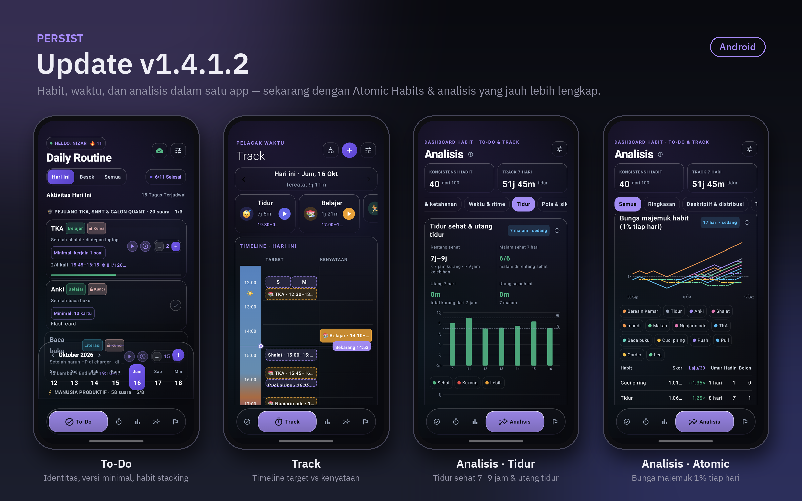

<div align="center">

# Persist — Releases

**Binary distribution and over-the-air update channel for Persist.**

[](https://github.com/stim-blip/persist-releases/releases/latest)
[](https://github.com/stim-blip/persist-releases/releases)


</div>

<p align="center">
  
</p>

This repository contains **release binaries only**. The application source is private.

Persist is a habit, time and goal system with offline-first storage, encrypted cloud sync, and a built-in analytics
engine (80+ analysis cards). Releases publish these artifacts:

| Artifact | Platform | File name |
| :--- | :--- | :--- |
| Android app | Android 8.0 (API 26) and newer | `Persist-vX.Y.Z.apk` |
| Linux desktop app | Debian / Ubuntu, amd64 | `persist_X.Y.Z-1_amd64.deb` |

> Since v1.4.0.1 releases are Android-only; the latest desktop build is **v1.4** (`persist_1.4-1_amd64.deb`).
> Early releases (v1.1 – v1.3.1) shipped the Android file as `app-release.apk`; see each release's assets.

## Install

**Easiest:** open the [latest release](https://github.com/stim-blip/persist-releases/releases/latest) and download
the file for your platform.

**Android**

1. Download the `.apk` on your phone (or `adb install Persist-vX.Y.Z.apk` from a computer).
2. Allow installation from your browser or file manager when Android asks.
3. Open Persist.

**Linux (Debian / Ubuntu)**

```bash
sudo dpkg -i persist_X.Y.Z-1_amd64.deb
```

Replace `X.Y.Z` with the version you downloaded.

## Updates

Both apps check a small version manifest and offer an update when a newer version is published. The download comes
straight from this repository's releases.

```
Persist app ──► version manifest ──► newer than installed?
                                           │ yes
                                           ▼
                                  update dialog ──► GitHub Releases (this repo)
```

You can always update manually by installing a newer file over the existing app.

## Release history

| Version | Highlights |
| :--- | :--- |
| **v1.4.1.3** | **Timelapse** card on Insight that replays your habit journey from day one (compound curves, habit × day map, running totals and moment labels like new streak records), a tidier Insight page, and a pinned "This week vs last week" card with a 4-week completion chart and bullet-point summary. |
| v1.4.1.2 | **Atomic Habits** (identity votes, two-minute minimal versions, habit stacking, *Reduce* mode with clean days) and a much bigger **Analisis** tab: new Sleep and Daily check-in groups, sleep health & debt, compound "1% a day" score, habit × day heat map, weekly summary, realistic targets, hourly screen time, unlocks and editable app categories. |
| v1.4.1.1 | Daily check-in (mood, energy, reasons for missed habits) with a 21:00 reminder, sleep quality after each sleep session, hourly screen time and unlocks synced, formula fixes. |
| v1.4.1 | To-Do and Track unified into one habit model, streamlined Insight screen, APK 44% smaller (~14 MB), smoother rendering, security hardening. |
| v1.4.0.2 | Sync fixes, log time without the stopwatch, glass design on every page, vertical 24-hour timelines, step-by-step bottom-sheet forms. |
| v1.4.0.1 | Task unlock takes effect immediately; swipe to edit/delete fixed. |
| v1.4 | **Track** time tracker linked to habits, **Goals v2** (milestones, phases, reflections, projections, weekly review), 33-card **Analisis** dashboard, real reminders with actions, interactive widget. Last desktop (DEB) release. |
| v1.3.3.5 | Mobile visual fixes and Supabase sync fixes. |
| v1.3.3.4 | **Insight engine** on the Analysis screen (Android and desktop): consistency score, plain-language findings, failure risk, day-of-week patterns, task dependencies, goal forecasts, and a backtested prediction model. New liquid-glass desktop UI. |
| v1.3.3.3 | One-tap task lock, slimmer task blocks, more transparent glass, refined dark mode. |
| v1.3.3.2 | Compact task cards and dark theme refinements. |
| v1.3.3.1 | Task lock, endless stack tasks with custom units, show-in-calendar option, category delete protection, vault-key QR pairing, Google Calendar / Keep / Tasks integration, home-screen widgets. |
| v1.3.3 | Dark-theme text fixes, v3 signing scheme, install compatibility for Android 13 Go. |
| v1.3.2 | Release-signed APK (fixes "App not installed"), license text correction. |
| v1.3.1 | Fix for persistent-failure detection (only evaluates fully elapsed days). |
| v1.3 | Multi-stack animations, heatmap pulse, volume bar animation, swipe gestures. |
| v1.2 | Analysis screen, heatmap, volume chart, streak tracking. |
| v1.1 | Initial release with core task management. |

Full notes for every version are on the [Releases page](https://github.com/stim-blip/persist-releases/releases).

## License

Persist is proprietary software. © 2026 Nizar / Xahara. All rights reserved. Reverse engineering and redistribution without permission are not allowed.

<div align="center"><sub>Built by <a href="https://github.com/stim-blip">Xahara</a> · Indonesia</sub></div>
